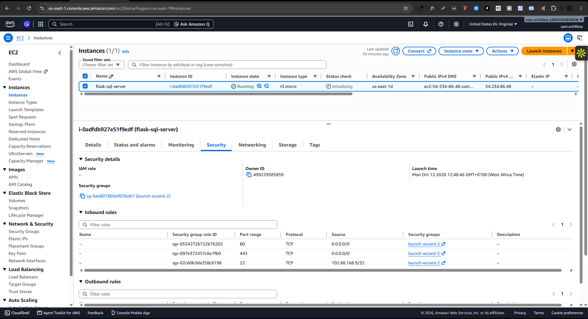

# Flask + MySQL Two-Tier Application | Docker Compose | AWS EC2

This project demonstrates practical DevOps skills in cloud infrastructure provisioning, Linux server administration, containerization, multi-container networking, database persistence, application health checks, reverse proxy configuration, and deployment troubleshooting.

## Architecture

```text
                  User / Web Browser
                          |
                          | HTTP :80
                          v
                 AWS EC2 Instance
                          |
                          v
                   Nginx Reverse Proxy
                          |
                          | 127.0.0.1:5000
                          v
                 Flask Application
                  Docker Container
                          |
                          | Docker Network
                          v
                  MySQL Database
                  Docker Container
                          |
                          v
                    Named Volume
                 Persistent Data
```

## Technology Stack

- **Cloud:** AWS EC2
- **Operating System:** Ubuntu 22.0 LTS
- **Application:** Python, Flask
- **Application Server:** Gunicorn
- **Database:** MySQL 8.0
- **Containerization:** Docker
- **Container Management:** Docker Compose
- **Reverse Proxy:** Nginx
- **Version Control:** Git and GitHub

## Step 1: Launch and Configure an AWS EC2 Instance

### 1.1 Launch the Instance

1. Sign in to the AWS Management Console.
2. Navigate to **EC2 → Instances → Launch instances**.
3. Enter a descriptive name, such as `flask-mysql-app`.
4. Select **Ubuntu 22.0 LTS** as the Amazon Machine Image (AMI).
5. Select an instance type suitable for the application's resource requirements and your budget.
6. Create or select an SSH key pair.
7. Configure the network and security group.
8. Launch the instance.



### 1.2 Configure the Security Group

Configure inbound rules according to the services exposed by the deployment.

| Port | Protocol | Source | Purpose |
|---|---|---|---|
| 22 | TCP | Your IP address | SSH administration |
| 80 | TCP | `0.0.0.0/0` | Public HTTP access |
| 443 | TCP | `0.0.0.0/0` | Future HTTPS access |

Do not create public inbound rules for MySQL port `3306` or Flask port `5000`.

### 1.3 Connect to EC2

From your local terminal, connect using the downloaded private key:

```bash
chmod 400 your-key.pem

ssh -i your-key.pem ec2-user@EC2_PUBLIC_IP
```

Replace `your-key.pem` and `EC2_PUBLIC_IP` with your actual key filename and instance public IP address.

## Step 2: Install Dependencies on EC2

The commands below target Amazon Linux 2023.

### 2.1 Update System Packages

```bash
sudo dnf update -y
```

### 2.2 Install Git, Docker, and Nginx

```bash
sudo dnf install -y git docker nginx
```

Verify the Git and Docker installations:

```bash
git --version
docker --version
```

Check whether the Docker Compose plugin is available:

```bash
docker compose version
```

If the Compose plugin is missing, install it using the supported installation procedure for your Amazon Linux 2023 environment.

### 2.3 Start and Enable Docker

```bash
sudo systemctl enable --now docker
```

Verify the service:

```bash
sudo systemctl status docker
```

### 2.4 Configure Docker Access

To run Docker commands without `sudo`:

```bash
sudo usermod -aG docker $USER
```

Apply the new group membership by logging out and reconnecting, or run:

```bash
newgrp docker
```

Verify access:

```bash
docker ps
```

Membership in the Docker group grants highly privileged access to the host. Only trusted users should be added.

### 2.5 Start and Enable Nginx

```bash
sudo systemctl enable --now nginx
```

Check its status:

```bash
sudo systemctl status nginx
```

## Step 3: Clone the Repository

Clone the project from GitHub:

```bash
git clone https://github.com/YOUR_USERNAME/flask-mysql-docker-compose.git
```

Move into the project directory:

```bash
cd flask-mysql-docker-compose
```

Replace `YOUR_USERNAME` with your GitHub username.

## Step 4: Configure Environment Variables

Create the deployment environment file:

```bash
cp .env.example .env
```

Edit it:

```bash
nano .env
```

Example configuration:

```dotenv
MYSQL_ROOT_PASSWORD=replace_with_a_strong_root_password
MYSQL_DATABASE=taskdb
MYSQL_USER=taskuser
MYSQL_PASSWORD=replace_with_a_strong_user_password
MYSQL_HOST=mysql
MYSQL_PORT=3306
```

Use strong, unique passwords. Keep `.env` out of version control and do not include actual production credentials in the repository.

The hostname `mysql` refers to the MySQL service on the Docker Compose network. It is not the EC2 public IP address or `localhost`.

## Step 5: Configure the Dockerfile

The Dockerfile packages the Flask application and its Python dependencies into an image.

```dockerfile
# Use an official Python runtime as the base image
FROM python:3.12-slim

# Set the working directory
WORKDIR /app

# Copy the requirements file first to improve build caching
COPY requirements.txt .

# Install Python dependencies
RUN pip install --no-cache-dir -r requirements.txt

# Copy the Flask application files
COPY app/ .

# Expose the application port
EXPOSE 5000

# Run the application using Gunicorn
CMD ["gunicorn", "--bind", "0.0.0.0:5000", "--workers", "2", "app:app"]
```

### Why these instructions matter

- `FROM` specifies the Python runtime used to build the image.
- `WORKDIR` sets the application's working directory inside the container.
- `COPY requirements.txt .` allows Docker to reuse the dependency-installation layer when application code changes but dependencies remain unchanged.
- `RUN pip install` installs the required Python packages.
- `COPY app/ .` copies the application code into the container.
- `EXPOSE 5000` documents the port used by the application.
- `CMD` starts Gunicorn, a production-oriented WSGI server for the Flask application.

The example assumes `requirements.txt` includes Flask, Gunicorn, and `mysql-connector-python`, and that `app.py` defines the Flask application as `app`.

**Note:** The original project uses `mysql-connector-python`, so additional system dependencies for `mysqlclient` are not required by this Dockerfile. If you change database drivers, review their build requirements.

## Step 6: Configure Docker Compose

Docker Compose defines the application and database services, networking, startup dependencies, environment variables, and persistent storage.

Example `docker-compose.yml`:

```yaml
services:
  web:
    build: .
    container_name: flask-app
    restart: unless-stopped
    ports:
      - "127.0.0.1:5000:5000"
    environment:
      MYSQL_HOST: ${MYSQL_HOST}
      MYSQL_PORT: ${MYSQL_PORT}
      MYSQL_DATABASE: ${MYSQL_DATABASE}
      MYSQL_USER: ${MYSQL_USER}
      MYSQL_PASSWORD: ${MYSQL_PASSWORD}
    depends_on:
      mysql:
        condition: service_healthy

  mysql:
    image: mysql:8.0
    container_name: mysql-db
    restart: unless-stopped
    environment:
      MYSQL_ROOT_PASSWORD: ${MYSQL_ROOT_PASSWORD}
      MYSQL_DATABASE: ${MYSQL_DATABASE}
      MYSQL_USER: ${MYSQL_USER}
      MYSQL_PASSWORD: ${MYSQL_PASSWORD}
    volumes:
      - mysql_data:/var/lib/mysql
      - ./mysql/init.sql:/docker-entrypoint-initdb.d/init.sql:ro
    healthcheck:
      test:
        [
          "CMD",
          "mysqladmin",
          "ping",
          "-h",
          "localhost",
          "-u",
          "root",
          "-p$${MYSQL_ROOT_PASSWORD}"
        ]
      interval: 10s
      timeout: 5s
      retries: 5
      start_period: 30s

volumes:
  mysql_data:
```

### Key Configuration Decisions

**Service communication:** The Flask application connects to MySQL using the Compose service hostname `mysql`.

**Persistent storage:** The `mysql_data` named volume stores database files outside the container's writable layer.

**Health checks:** Docker monitors MySQL readiness, and Compose waits for the database health check before starting the web service.

**Restricted application port:** Flask is published on `127.0.0.1:5000`, making it accessible from the EC2 host but not directly through the instance's public network interface.

**Database isolation:** MySQL has no public port mapping. The application communicates with it over the internal Compose network.

## Step 7: Build and Start the Application

Validate the Compose configuration:

```bash
docker compose config
```

Build the application image and start the services:

```bash
docker compose up -d --build
```

Check the running containers:

```bash
docker compose ps
```

View application logs:

```bash
docker compose logs --tail=100 web
```

View database logs:

```bash
docker compose logs --tail=100 mysql
```

## Step 8: Configure Nginx as a Reverse Proxy

Nginx acts as the public entry point and forwards HTTP requests to the Flask container.

Inspect the existing configuration before editing:

```bash
sudo nginx -T
```

For an Nginx installation using `/etc/nginx/conf.d/`, create a configuration file:

```bash
sudo nano /etc/nginx/conf.d/flask-app.conf
```

Example configuration:

```nginx
server {
    listen 80;
    server_name _;

    location / {
        proxy_pass http://127.0.0.1:5000;

        proxy_set_header Host $host;
        proxy_set_header X-Real-IP $remote_addr;
        proxy_set_header X-Forwarded-For $proxy_add_x_forwarded_for;
        proxy_set_header X-Forwarded-Proto $scheme;
    }
}
```

The `server_name _;` setting provides a catch-all hostname for requests not matched by a more specific server block. Ensure the existing Nginx configuration does not conflict with this server block or continue serving the default welcome page.

Validate the configuration:

```bash
sudo nginx -t
```

If validation succeeds, reload Nginx:

```bash
sudo systemctl reload nginx
```

## Step 9: Verify the Deployment

### 9.1 Test Flask Locally on EC2

```bash
curl -i http://127.0.0.1:5000/health
```

This checks the application directly without involving Nginx.

### 9.2 Test Through Nginx

```bash
curl -i http://127.0.0.1/health
```

A successful response should return HTTP `200 OK` and JSON indicating that the application is healthy and the database is connected.

### 9.3 Access the Application Publicly

Open the following URL in a browser:

```text
http://EC2_PUBLIC_IP
```

Replace `EC2_PUBLIC_IP` with the instance's actual public IPv4 address.

**Deployment result:** The Flask application was successfully deployed to AWS EC2 and accessed through its public IP address using Nginx as a reverse proxy.

## Step 10: Data Persistence Verification

To verify that database records survive normal container recreation, restart the Compose stack:

```bash
docker compose down
docker compose up -d
```

Open the application again and confirm that existing tasks remain available.

The named volume preserves the MySQL data when containers are removed and recreated, as long as the volume itself is retained.

Avoid `docker compose down -v` during this test because it removes Compose-managed named volumes.

## Troubleshooting

| Symptom | Investigation |
|---|---|
| Nginx welcome page appears | Inspect active Nginx server blocks and verify `proxy_pass` |
| Flask container exits | Review `docker compose logs web` |
| MySQL is unhealthy | Inspect MySQL logs, credentials, and health-check configuration |
| Health endpoint returns HTTP 503 | Check database connectivity and Flask logs |
| Public IP is unreachable | Check the EC2 security group, Nginx status, and host firewall |
| Port 5000 is unavailable | Inspect local listening ports and Docker port bindings |
| Tasks disappear | Verify the named volume and whether it was removed |

Useful diagnostic commands:

```bash
docker compose ps
docker compose logs --tail=100 web
docker compose logs --tail=100 mysql
sudo nginx -t
sudo systemctl status nginx
sudo tail -n 50 /var/log/nginx/error.log
```

## Security Considerations

- Exclude `.env` and all deployment secrets from Git.
- Restrict SSH access to trusted IP addresses.
- Avoid exposing MySQL port `3306` publicly.
- Bind Flask to the host's loopback interface and expose HTTP through Nginx.
- Keep the operating system, Docker images, and application dependencies updated.
- Configure database backups and test recovery procedures.
- Enable HTTPS before using the application to handle sensitive information.

The current deployment uses HTTP because a domain name and TLS certificate have not yet been configured. HTTPS is a planned improvement.

## Future Improvements

- Configure a domain name and HTTPS using a trusted TLS certificate.
- Automate builds and deployment using GitHub Actions.
- Introduce automated application and database tests.
- Implement database backup and recovery procedures.
- Add monitoring, logging, and alerting.
- Integrate container image and dependency vulnerability scanning.
- Use infrastructure as code to provision repeatable AWS environments.
- Introduce dedicated secret management for deployment credentials.

## Skills Demonstrated

- AWS EC2 provisioning and Linux server administration
- Docker image creation and container lifecycle management
- Docker Compose multi-service deployment
- Flask application configuration and Gunicorn
- MySQL service connectivity and persistent storage
- Health checks and service startup dependencies
- Nginx reverse proxy configuration
- Cloud network security and port exposure management
- Application troubleshooting and deployment validation
